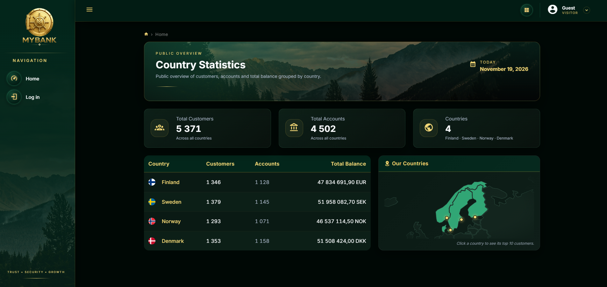

# 🏦 MyBank - Bankadministrationssystem

<p align="center">
  
</p>

Ett administrationssystem för bankens anställda (**Admins** och **Cashiers**), byggt med **ASP.NET Core Razor Pages**, **Entity Framework Core** och **ASP.NET Core Identity**.
Systemet hanterar kunder, konton, saldon och transaktioner mot en befintlig bankdatabas (Database First).
Utvecklat som en del av utbildningen Systemutvecklare .NET på YH Akademin.
Projektet är byggt som ett riktigt bankadministrationssystem med fokus på arkitektur, lagerindelning, validering, säkerhet och användarroller.

> Kunderna är inte systemanvändare. Det är bankens anställda som loggar in och arbetar i systemet.

---

## 🌍 Live-demo

**Azure:** https://bankapp-ninnie-afebhbh6b8cjezg0.swedencentral-01.azurewebsites.net

---

## 🔐 Inloggning

| Roll | E-post | Lösenord |
|---|---|---|
| Admin | robert.johansson@admin.se | Abc123# |
| Cashier | robert.johansson@cashier.se | Abc123# |

Rollerna och användarna skapas automatiskt (seed) vid uppstart om de inte redan finns.

---

## ✨ Funktionalitet

### 🌐 Startsida (publik)
- KPI-kort med totalt antal kunder, konton och länder
- Tabell med statistik per land: antal kunder, antal konton och totalt saldo
- Klickbar karta och klickbara länder som leder till landssidan
- Kräver ingen inloggning

### 🏆 Topp 10 per land (publik)
- De 10 kunder med högst totalt saldo i valt land, med placering, kundnummer, namn och stad
- KPI-kort med antal toppkunder, genomsnittligt saldo och totalt saldo
- **Response Caching** i 60 sekunder, en version per land (`VaryByQueryKeys = "country"`)
- `[AllowAnonymous]`, eftersom Response Caching bara fungerar för utloggade användare

### 🔎 Snabbsökning på kundnummer
- Sökfält i navbaren, synligt för Admin och Cashier
- Kundbilden öppnas direkt om kunden finns, annars visas ett felmeddelande
- Server-side-validering. Sökfältet i navbaren har bara `min="1"` i webbläsaren

### 👥 Kundsökning
- Sök på kundnummer eller namn, och på stad
- Visar kundnummer, personnummer, namn, adress och stad
- Sortering stigande/fallande på alla kolumner
- Paginering med 50 kunder per sida (föregående/nästa)
- Klick på en kund öppnar kundbilden

### 👤 Kundbild
- All information om kunden: namn, kundnummer, personnummer, kön, födelsedag, adress, stad, land, telefon och e-post
- Kundens samtliga konton med saldo
- Totalt saldo för kundens konton
- Snabbknappar för insättning, uttag och överföring per konto (Cashier)

### 💳 Kontobild
- Kontonummer, saldo, kontoägare, frekvens och skapandedatum
- Transaktioner sorterade med nyaste först
- **AJAX "Show more"**: hämtar 20 transaktioner i taget med `fetch` utan sidladdning, och knappen döljs när det inte finns fler

### 💰 Insättning, uttag och överföring (Cashier)
- Saldot ändras **aldrig direkt**, bara genom en transaktion
- `decimal` för alla belopp, för att undvika avrundningsfel
- Tydligt felmeddelande om saldot är för lågt vid uttag och överföring
- Överföring skapar två transaktioner (ut från avsändaren, in till mottagaren) i samma `SaveChanges`, så att båda sparas eller ingen
- De 5 senaste transaktionerna på kontot visas under formuläret (partial `_RecentTransactions`)

### ➕ Skapa och ändra kund (Cashier)
- Cashier kan skapa en ny kund (**New customer**) och ändra en befintlig kund (**Edit customer**)
- Kunden får automatiskt ett nytt unikt kundnummer, som databasen delar ut
- Ett transaktionskonto med kunden som ägare skapas automatiskt, och kund, konto och koppling sparas i samma `SaveChanges`
- Samma formulär används för att skapa och ändra (`CustomerFormViewModel` och partialen `_CustomerForm`)
- **Server-side:** data annotations och `ModelState.IsValid`. **Client-side:** jQuery Validation i webbläsaren
- Kön och land väljs i dropdown, och en födelsedag i framtiden nekas
- Skyddad med `[Authorize(Roles = "Cashier")]`

### 📊 Dashboard (Admin)
- Personlig hälsning efter tid på dygnet
- Kort per land med kunder, konton och totalt saldo, som leder till topp 10
- Stapeldiagram med antal kunder per land
- De 5 senaste transaktionerna i banken, med klickbara namn som öppnar kontot

### 👤 User Admin (Admin)
- Admin kan **skapa, läsa, uppdatera och ta bort** systemanvändare (CRUD) och tilldela roll (Admin eller Cashier)
- Skyddad med `[Authorize(Roles = "Admin")]`
- Lösenord hanteras av `UserManager` (Identity), aldrig i klartext
- De två seedade kontona är markerade **Protected** och kan inte tas bort
- Man kan inte ta bort sig själv eller ändra sin egen roll
- Servicen `IUserService` pratar med Identity, sidorna använder ViewModels (`CreateUserViewModel`, `EditUserViewModel`)

### 🚨 Misstänkta transaktioner (Admin)
- Sidan `/Admin/Suspicious` visar misstänkta transaktioner för ett valt land. Bara Admin har åtkomst, Cashier och utloggade skickas vidare.
- Sökningen körs först när man trycker **Show**, och resultatet sparas i minnet i 5 minuter per land och period (`IMemoryCache`), så att sidbyte går direkt
- Samma regler som konsolappen, via samma service (`SuspiciousTransactionService`): en enskild transaktion över 15 000, eller en kunds summa över 23 000 de senaste tre dagarna.
- Sammanfattningskort (antal, summa och antal per regel), listan är paginerad med 50 per sida och har länkar till kundbild och kontosida.
- Snabb fråga: kontoägare hämtas först, sedan bara matchande transaktioner, och kopplingen sker i minnet.

### 🕵️ Konsolapp: misstänkta transaktioner
- Eget konsolprojekt (`BankApp.SuspiciousTransactions`) som återanvänder `BankAppContext` och servicen `ISuspiciousTransactionService` (DRY)
- Körs för varje land, och regel 2 summeras per kund:
  1. En enskild transaktion över 15 000 kr, oavsett om pengarna sätts in eller tas ut
  2. En kunds samlade belopp (in och ut, som absolutbelopp) de senaste 3 dygnen över 23 000 kr (`Date` är ett `DateOnly` i databasen, så 72 timmar räknas som 3 dagar)
- Skapar en rapport som .txt-fil per land i `Dokument\BankAppReports`, med person, kontonummer och transaktionsnummer
- Sparar senast kontrollerade transaktions-id i `last-checked-transaction-id.txt`, så att nästa körning bara rapporterar **nya** misstänkta transaktioner
- Tabeller och färger med Spectre.Console, i samma färger som webben
- Tolkning: programmet körs per land och grupperar träffarna per kund. Regel 2 räknar absolutbelopp, så att insättningar och uttag läggs ihop. Kravet nämner inte om belopp ska räknas med tecken, så vi har valt absolutbelopp

### 🛡️ Inloggning, roller och behörighet
- Egen inloggningssida, ingen öppen registrering
- Utloggning sker med ett POST-formulär som skyddas av en antiforgery-token
- **Admin:** dashboard, User Admin (skapa, läsa, ändra och ta bort användare samt tilldela roll), misstänkta transaktioner, kundsökning, kundbild och kontobild. Admin kan se kunder men inte ändra dem
- **Cashier:** kundsökning, kundbild, kontobild, skapa och ändra kund, insättning, uttag och överföring
- `[Authorize(Roles = "...")]` varje skyddad sida, även om någon skriver adressen direkt
- Menyn visar bara det som användarens roll har tillgång till

---

## 🧱 Arkitektur

Lösningen är uppdelad i **tre lager** (webb, services, data) plus en **konsolapp**. Sidorna pratar aldrig direkt med databasen, de går alltid via en service.

```
Razor Page (PageModel)  →  Service  →  DbContext  →  SQL Server
     ↑ ViewModel                ↑ DTO / entitet
     (AutoMapper)
```

**Exempel – överföring:** `Transfer.cshtml.cs` validerar `TransferViewModel` →
`IAccountService.TransferAsync()` kontrollerar saldot och skapar två transaktioner →
`BankAppContext.SaveChangesAsync()` sparar båda på en gång, eller ingen.

### **BankApp – Webbapplikation**
- Tar emot förfrågan, validerar indata i ViewModels och visar resultatet. Innehåller ingen affärslogik.
- Razor Pages (`.cshtml` + PageModel)
- ViewModels med validering
- AutoMapper-profil (`MappingProfile`)
- Helpers: landsflaggor (`CountryFlags`), valutakod per land (`CountryCurrency`), svensk tid (`SwedishTime`) och visningsnamn för inloggad användare (`UserDisplay`)
- `Program.cs`: dependency injection, Identity, Response Caching, `IMemoryCache` och migrering vid uppstart

### **BankApp.Services – Affärslogik**
- Bankens regler: kontrollerar saldo, skapar transaktioner och returnerar en ErrorCode när något inte är tillåtet.
- `ICustomerService`, `IAccountService`, `ITransactionService`, `IDashboardService`, `IUserService` (användare och roller via Identity) och `ISuspiciousTransactionService` (reglerna för misstänkta transaktioner)
- All logik för insättning, uttag och överföring
- `ErrorCode` (enum) som PageModel översätter till felmeddelanden

### **BankApp.DataAccessLayer – Data**
- Pratar med databasen via EF Core. Entiteter och DbContext lämnar aldrig det här lagret till vyerna.
- Entiteter och `BankAppContext` (Database First)
- `ApplicationDbContext` och migrering för Identity
- DTO:er
- `SeedData` för roller och användare

### **BankApp.SuspiciousTransactions – Konsolapp**
- Startar sökningen, skriver rapporterna och sparar var körningen slutade. Reglerna ligger i servicen, inte här.
- `Program.cs` och `ReportWriter` (skriver .txt-rapporten)

---

## ✅ Validering

- Data annotations på ViewModels (`[Required]`, `[Range]`, `[StringLength]` m.fl.) med egna felmeddelanden
- **Server-side:** `ModelState.IsValid` kontrolleras innan något sparas eller söks
- **Client-side:** jQuery Validation (installerat med LibMan i `wwwroot/lib`) via `_ValidationScriptsPartial` på formulären: inloggning, kundsökning, insättning, uttag, överföring samt skapa och ändra kund. Snabbsökningen i navbaren har bara `min="1"` i webbläsaren, och validering görs på söksidan
- Regler som kräver databasen (t.ex. för lite pengar eller ett mottagarkonto som inte finns) returneras som `ErrorCode` från servicen och visas med `ModelState.AddModelError`
- Ett kund- eller kontonummer som inte finns i adressen ger 404

---

## 🎨 Design

- Bygger på **Corona Admin (Free Bootstrap Template)**, omgjord med egen stilmall (`wwwroot/my-css/style.css`)
- Mörka skogsgröna ytor, guld som primärfärg och grönt som accent
- Huvudfärgerna ligger som CSS-variabler i `:root`, så de kan ändras på ett ställe
- Typsnittet Inter med tabulära siffror, så att belopp linjerar i kolumner
- Egen logga och tagline: *TRUST • SECURITY • GROWTH*
- Responsiv: fungerar på mobil, surfplatta och dator. På mobil blir tabellerna kort med etiketter, och kort och knappar anpassas efter skärmbredden

---

## 🧪 Tekniker

- .NET 10 / ASP.NET Core Razor Pages
- Entity Framework Core 10 (Database First) + LINQ
- ASP.NET Core Identity (roller: Admin, Cashier)
- AutoMapper
- SQL Server
- JavaScript (`fetch` / AJAX)
- jQuery Validation
- Bootstrap (Corona Admin Free)
- Git & GitHub 
- Console Application med Spectre.Console

---

## 📁 Projektstruktur

```
BankApp/                         Webbapplikationen
  Pages/                         Razor Pages (Admin/, Shared/)
  ViewModels/                    ViewModels med validering
  Mapping/                       AutoMapper-profil
  Helpers/                       CountryFlags, CountryCurrency, SwedishTime, UserDisplay
  wwwroot/my-css, my-js          Egen CSS och JavaScript
BankApp.Services/                Services, interfaces, ErrorCode
BankApp.DataAccessLayer/         Entiteter, DbContexts, DTO:er, migrering, seed
BankApp.SuspiciousTransactions/  Konsolapp som söker misstänkta transaktioner
image/                           Bilder till README
BankApp.slnx
README.md
```

---

## 🛠️ Installation (F5 mot egen databas)

**Krav:** Visual Studio 2026, .NET 10 SDK, SQL Server

1. Återställ `BankAppDatav2.bak` i SQL Server Management Studio
2. Kör (byt till ditt databasnamn):
   ```sql
   ALTER AUTHORIZATION ON DATABASE::[databasnamn] TO [sa]
   ```
3. Öppna `BankApp/appsettings.json` och ändra `Server=` och `Database=` i **båda** connection strings (`DefaultConnection` och `IdentityConnection`)
4. Öppna `BankApp.slnx`, kontrollera att **BankApp** är startprojekt och tryck **F5**

Vid första start skapas Identity-tabellerna automatiskt (`MigrateAsync` i `Program.cs`), och därefter seedas roller och användare. Banktabellerna finns redan i `.bak`-filen.

### Konsolappen (valfritt, för att köra rapporten)

1. Öppna `BankApp.SuspiciousTransactions/appsettings.json` och ändra `Server=` och `Database=` till samma som i BankApp
2. Högerklicka **BankApp.SuspiciousTransactions** i Solution Explorer → **Debug** → **Start Without Debugging**, så står fönstret kvar när rapporten är klar (eller kör `dotnet run --project BankApp.SuspiciousTransactions` i terminalen)
3. Rapporterna sparas i `Dokument\BankAppReports`. Första körningen rapporterar hela historiken, och efter det bara nya transaktioner. Ta bort filen `last-checked-transaction-id.txt` för att börja om

Konsolappen körs lokalt, inte i Azure.

---

## 🧩 Lärdomar & Arbetssätt

Jag arbetade enligt principer som:

- **Separation of concerns:** sida, logik och data i olika projekt
- **DRY:** partials och services som återanvänds, och flagglogiken samlad på ett ställe
- **Branches:** används för större ändringar, t.ex. `suspicious-page` och `design/fix-layout`.
- **Validering från början:** varje nytt formulär byggs med server- och client-side-validering direkt
  
Lärdomar:

- Jag borde ha skapat klassbiblioteken och planerat lagren tidigare
- I början använde jag ViewModels där DTO:er passade bättre
- Git-mappen låg först inne i webbprojektet, så klassbiblioteken kom inte med till GitHub. Jag flyttade upp repot en nivå
- Statistiken får bara räkna kontoägare (`OWNER`), annars räknas delade konton dubbelt
- Utan `MigrateAsync` vid uppstart hade appen kraschat mot en nyss återställd databas
- Validera först, ändra data sedan: ordningen i OnPost spelar roll
- Nästa gång gör jag moodboard och sidplanering innan jag designar
- Frågor som börjar i `Transactions` (filtrera först, koppla sedan till kund) gick på sekunder, medan frågor som började hos kunden tog över 30 sekunder i den stora databasen
- `Date` på transaktioner saknar klockslag, så regeln om 72 timmar blev 3 dagar
- Webbens SQL-timeout var 30 sekunder, och en fråga som joinade över en miljon transaktioner gav timeout. Jag delade upp den i tre enkla steg (ägare, matchande transaktioner, koppling i minnet) och höjde timeouten till 120 sekunder

---

## ✍️ Utvecklat av
**Ninnie Dahlström – Systemutvecklare .NET, YH Akademin**
